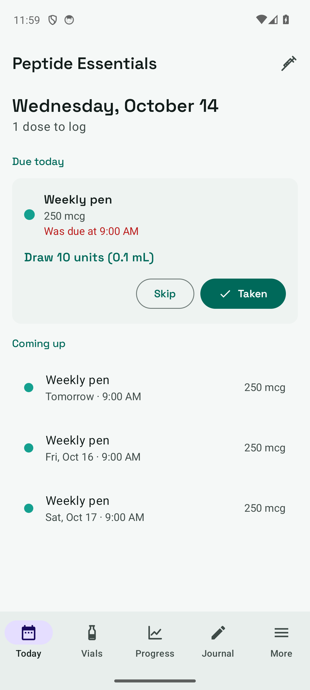
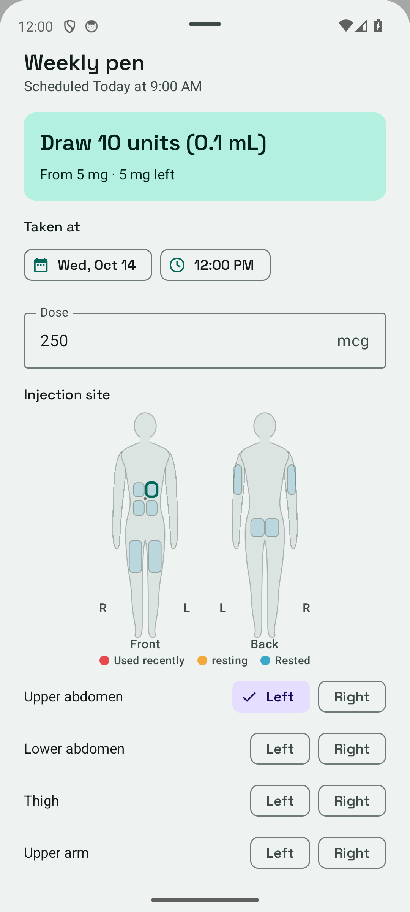
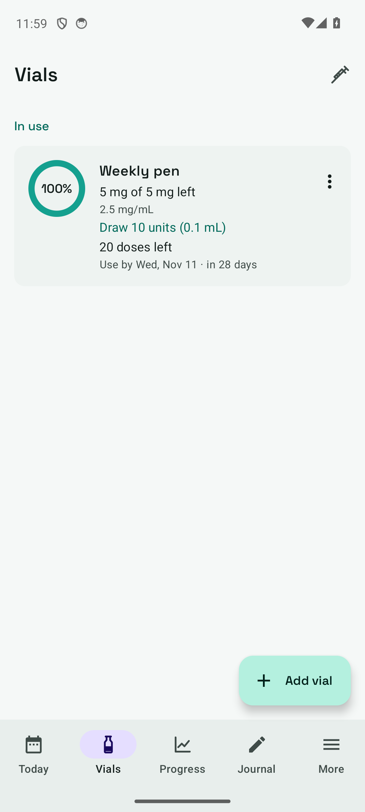
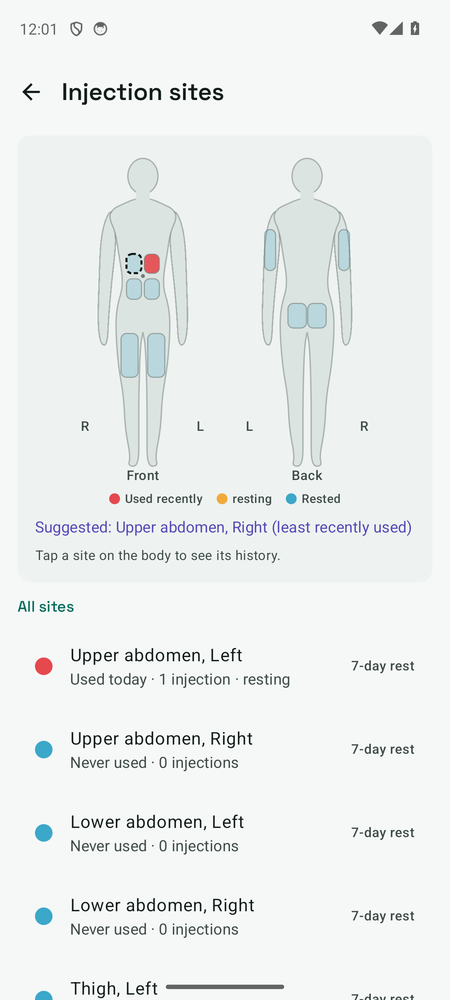
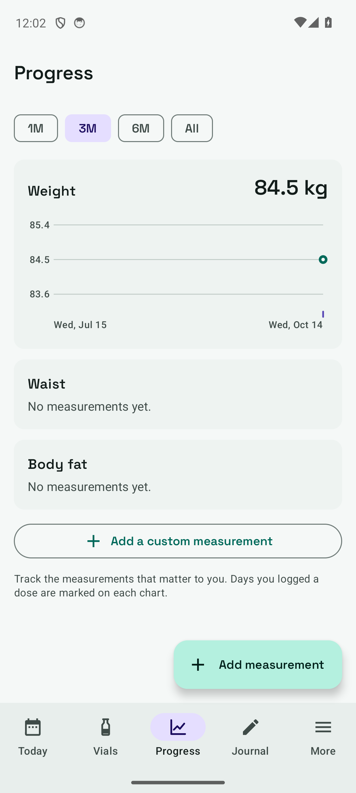
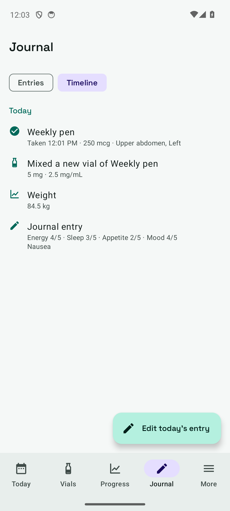
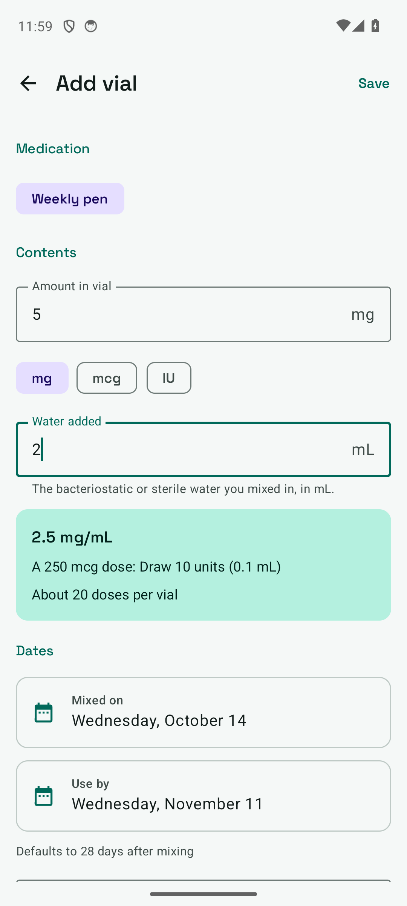

# Peptide Essentials

An all-in-one, offline tracker for the peptide and injection medications you've been prescribed: vials, doses,
reminders, injection-site rotation, progress and a daily journal — with a PDF report for your prescriber.

> **Not medical advice.** Peptide Essentials is a personal log, not a medical device. It doesn't recommend
> medications, doses or schedules, and ships with no presets. Always follow your prescriber or pharmacist.

## Screenshots

<table><tr><td align="center"><br><sub>Today</sub></td><td align="center"><br><sub>Log a dose on the body model</sub></td><td align="center"><br><sub>Vial inventory</sub></td><td align="center"><br><sub>Injection-site heat map</sub></td><td align="center"><br><sub>Progress</sub></td><td align="center"><br><sub>Timeline</sub></td><td align="center"><br><sub>Vial + calculator</sub></td></tr></table>

## Features

- **Today:** doses due, missed and upcoming, each showing "Draw N units (X mL)" from the active vial; log Taken/Skipped,
  also straight from the reminder notification.
- **Vials:** amount, water added, mix and use-by dates, lot; remaining amount counts down with each dose; low-stock and
  expiry alerts.
- **Calculator:** reconstitution maths with a to-scale U-100 syringe (0.3/0.5/1 mL), reverse mode, safety warnings.
- **Injection sites:** front/back body model with 10 sites, recency heat map, rest periods, suggestions, per-site
  history and reactions.
- **Progress:** weight, waist, body fat and custom metrics with Canvas trend charts and dose-day markers.
- **Journal & timeline:** daily ratings, side effects, notes, and a merged day-by-day timeline.
- **Export:** PDF report (adherence, doses, trends, side effects), CSV per table, full JSON backup/restore.
- **Private:** no internet permission, no accounts, no analytics. Data is excluded from cloud backup.

## Build

Requirements: JDK 17+ (21 recommended) and the Android SDK (compileSdk 36).

```sh
echo "sdk.dir=$HOME/Android/Sdk" > local.properties
./gradlew testReleaseUnitTest assembleRelease bundleRelease
```

Unit tests cover schedule maths (daily / weekdays / every N days across month ends, leap days and DST
transitions), the Today planner and site rotation.

### Release signing

Release builds are signed from `keystore.properties` in the project root (git-ignored):

```properties
storeFile=/path/to/release.jks
storePassword=...
keyAlias=...
keyPassword=...
```

or, in CI, from the `KEYSTORE_FILE`, `KEYSTORE_PASSWORD`, `KEY_ALIAS` and `KEY_PASSWORD` environment variables.
Without either, release builds fall back to the debug key.

GitHub Actions builds the APK and App Bundle on every push; pushing a `v*` tag publishes a release with
`PeptideEssentials.apk` and `PeptideEssentials.aab`. The workflow expects the secrets `KEYSTORE_B64` (base64 keystore),
`KEYSTORE_PASSWORD`, `KEY_ALIAS` and `KEY_PASSWORD`.

## Project layout

```
app/src/main/java/io/github/deveshb1/peptideessentials/
  data/        models, JSON codec, repository (StateFlow + atomic file)
  schedule/    schedule maths, Today planner, site rotation
  reminders/   alarm scheduling, notification, receivers
  export/      CSV export and JSON backup
  ui/          Compose screens, components and theme
```
